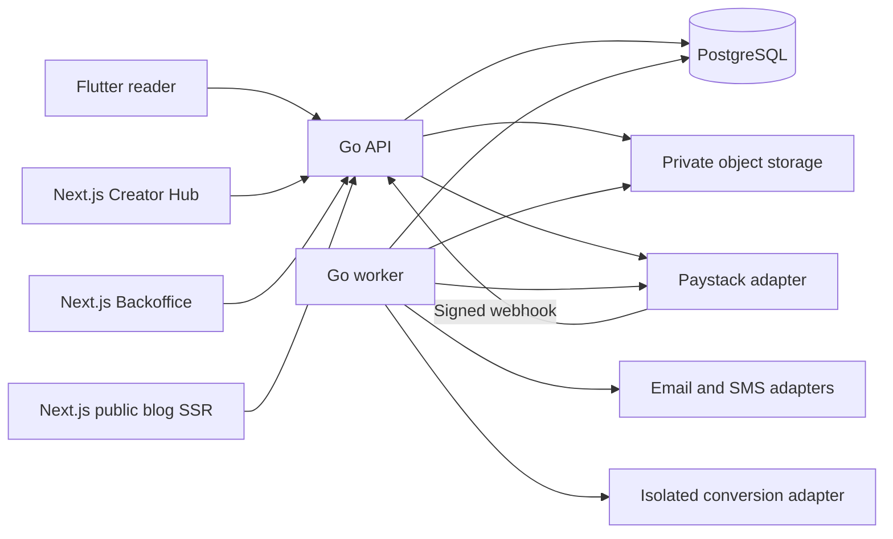

# Target architecture: Go-owned backend

This is a proposal. The existing Firebase implementation remains the behavior reference until each capability is migrated and checked. The target has no Firebase runtime dependency. An explicitly time-limited identity/data compatibility bridge may be needed during migration.

The [title and digital-media specification](TITLES_AND_DIGITAL_MEDIA.md) defines the updated domain: optional series membership -> title -> editorial edition -> language edition -> ebook/audiobook delivery variants -> content releases/assets. The [relationship review](ENTITY_RELATIONSHIPS.md) specifies cross-domain cardinalities, authority, publication snapshots and access provenance. Wolly is electronic-only; no physical-book entities or fulfillment are planned.

Scope revision: [unified titles, offers and subscriptions](CONTENT_OFFERS_AND_SUBSCRIPTIONS.md) defines blog posts as titles, source/editor authoring, mutually exclusive free/paid title classification, lifetime and/or subscription routes for paid titles, and independent grant provenance. Release order is R1 free ebooks → R2 free audio → R3 lifetime monetisation → R4 publisher teams → R5 households/minors → R6 sponsored consumption → R7 subscription programme → R8 full rollout. Earlier source inventories describe legacy behavior, not an exception to this target.

## Content-type extension boundary

Follow the [content-type and container plan](CONTENT_TYPES_AND_CONTAINERS.md). `Title` denotes a finite work, with server-owned `work_type` (`book` initially, `blog_post` enabled with the unified editor path by R3) at launch and a typed `book_details` profile distinguishing novel/textbook/monograph/reference/anthology. Subject, audience, content language, delivery kind and file rendition remain separate dimensions. One managing account may create books and existing blog content; future supported profiles use that same identity foundation.

Future newspapers/magazines/journals have separate `serial_publications` and typed issue-title relationships; do not overload book series or legacy blog publications. An issue date/number identifies a new finite work, while content corrections create releases. Composition of independently identified articles/stories uses typed, ordered, version-pinned placements when that feature is implemented. No series/container relation grants access implicitly.

Keep shared identity, credits, assets, rights, publication snapshots, settlement and audit services. Add type-specific schema/commands/readiness/renderers inside the monolith. A versioned capability contract gates authoring, consumption and commerce independently; unknown or disabled work types cannot be published/purchased through generic title patches. Editor-backed web_text and monthly package coverage are now core scoped extensions; future periodical/archive-specific promises still need their own acceptance; do not weaken launch delivery FKs or repurpose blog paid state. B0–B13 remain book-first; E1–E4 in the content-type plan describe later acceptance gates.

### Relationship map and implementation scope

```text
User ── membership ── ManagingAccount ── manages ── catalog resources
Party ── typed credits ── Title / TitleEdition / LanguageEdition / Delivery
Series ←── ordered membership ──→ Title
Title → TitleEdition → LanguageEdition → Delivery variant → ContentRelease
Delivery → PublicationRevision → exact release + approved metadata/artwork/terms
Purchase → EntitlementGrant → effective User/Delivery access
Sale → frozen beneficiary/liability → payout allocations

Later: SerialPublication → issue Title → edition/language/delivery structure
Later: container composition revision → ordered, pinned component placements
```

Series is a membership graph; content ancestry is a checked parent chain. Neither graph supplies management permission, verified rights, customer access or beneficiary allocation on its own. The current publication pointer must reference a snapshot of that same delivery; derive the published release from it rather than maintaining disagreeing pointers. Metadata-only publication updates can reference unchanged content. Each branch can be drafted/published independently.

| SQL/module boundary | Book launch B1–B13 | Later feature gate |
| --- | --- | --- |
| Catalog | `titles.work_type`, typed book details/academic descriptive metadata; series, editions, languages, variants and credits | E1 short-work profiles; explicit type migrations and contract versions |
| Continuing publications | Blog posts map to canonical titles/web_text; publications become channels and tiers map to scoped packages/price versions | E2 `serial_publications`, serial metadata revisions, `periodical_issue_details` with unique serial/issue key; optional volume labels, dated archive commands |
| Composition | Book navigation and audio chapter manifests; no implicit independently sellable chapters | E3 composition revisions and typed placements bound to exact container/component language editions and approved snapshots; enforce cycle/authority checks |
| Scholarly workflow | Academic book description and tested PDF/EPUB fidelity; no inferred peer-review status | E3 revision-bound citations, explicit review evidence and correction/retraction decisions before any associated badge or publication claim |
| Commercial coverage | Free/lifetime offers and R7 monthly packages with explicit coverage, attributable grants and retained-access policy | E4 extensions for periodical/archive-specific coverage, installments and advanced bundles; no generic paid-content flag |

Future table/module names specify boundaries, not migrations to run during B0 or dormant tables to create during book launch. Introduce `internal/periodicals` and composition services when the associated gate is implemented; reuse shared authorization, assets, rights, publication, settlement and audit boundaries. The book-profile registry is Go-owned and versioned, not a creator-defined schema engine.

## Delivery architecture and release gates

The [roadmap](PRODUCT_ROADMAP.md) stages customer outcomes rather than deploying whole backend milestones in isolation. Shared identity/account/profile/Party, ancestry/publication and grant contracts precede exposure; enabled types/roles/offers/surfaces are versioned in the release manifest. R1 proves free ebooks, R2 free audio, R3 lifetime sales, R4 publisher teams, R5 profiles, R6 sponsored consumption and R7 general subscription packages; R8 completes agreed parity. The proposed consumer web reader needs a real application/hosting boundary and browser-safe auth, assets/rendering and progress, beyond existing Creator Hub previews.

Use additive migrations and compatible API/client deployment, then cohort activation and domain-specific single-writer cutover. Keep callback/inbox ownership and rollback/fix-forward evidence per release. R0 verifies true environment/data/provider isolation: the existing `develop` workflow's preview web channels do not isolate shared functions/rules or the blog live deployment. The [release execution plan](RELEASE_PLAN.md#existing-deployment-constraints-to-resolve-in-r0) records source evidence and tasks; this document does not change that workflow or select a new host.

## Application shape



Start with a modular monolith: one codebase, one database, two commands. Keep HTTP parsing, domain decisions, and SQL separate without inventing a generic repository layer for every table.

```text
backend/go/
  cmd/api/                 HTTP server and dependency wiring
  cmd/worker/              durable jobs and scheduled work
  cmd/migrate/             explicit versioned database migrations
  cmd/import/              repeatable legacy import; added near cutover
  internal/config/
  internal/httpapi/         routing, DTOs, errors, middleware
  internal/identity/        accounts, challenges, credentials, sessions, permissions
  internal/catalog/        titles, eligible deliveries, genres, search, public authors
  internal/reading/         reading/listening progress, bookmarks, follows, preferences
  internal/publishing/      deliveries, releases, reports, agreements, staff review
  internal/rights/          grants, declarations, evidence, availability cases
  internal/commerce/        attempts, purchases, entitlements, refunds
  internal/finance/         ledger, revenue policies, payout runs and statements
  internal/channels/        publication branding, canonical title placements, routes, feeds
  internal/editor/          structured drafts, revisions, sanitization and web_text rendering
  internal/subscriptions/   packages, coverage versions, monthly periods, comps, cancellation
  internal/engagement/      reviews, likes, comments, reports
  internal/notifications/   newsletters, consent, delivery, suppressions
  internal/media/           upload validation, storage adapter, authorized ebook/audio delivery
  internal/audio/           chapter manifests, probing, transcoding, audio quality profiles
  internal/jobs/            inbox/outbox, leases, retries, schedules
  internal/audit/
  internal/providers/      paystack, email, sms, conversion
  migrations/
  api/                     versioned OpenAPI contract and example payloads
```

Use standard `net/http` method/path routes, `encoding/json`, request contexts, `slog`, `httptest`, `database/sql` with pgx, and explicit SQL migrations. Pin supported toolchain/dependency versions when implementation starts. Learn SQL before adding an ORM or code generator. Go's [HTTP library](https://pkg.go.dev/net/http) and [transaction guide](https://go.dev/doc/database/execute-transactions) support this approach; the package boundaries above are a project recommendation.

## Replace platform responsibilities completely

| Current platform behavior | Target responsibility |
| --- | --- |
| Firebase Auth and browser/mobile auth state | Go-owned credentials/verified identities and session lifecycle |
| Firestore reads, writes, transactions, indexes | Scoped SQL queries, explicit service commands, constraints and migrations |
| Firestore security rules | Permission checks and field allowlists in Go; database constraints as additional enforcement |
| Cloud Functions and callable envelopes | Versioned HTTP API and consistent errors |
| Firestore write triggers | Service transactions plus durable outbox jobs; no invisible client side effects |
| Scheduled functions | Worker schedules with persisted run identity, lease recovery and reconciliation |
| Storage upload rules and token URLs | Validated uploads, asset ownership, private storage and authorized delivery |
| Snapshot listeners | Bounded polling with version/ETag first; authenticated SSE only where justified |
| Offline Firestore cache | Explicit per-account device/browser cache; conflict-aware sync |
| Hosting/App Distribution | Separate delivery concern; keep current client hosting/distribution initially |
| Firebase Admin SDK in blog SSR | Ordinary API calls with verified viewer identity; no database bypass in Next.js |

## Household consumption profiles

Follow [reader profiles and household access](READER_PROFILES_AND_HOUSEHOLDS.md). Add `reader_profiles`, `profile_access_grants`, `profile_policy_revisions`, scoped `profile_sessions`/device credentials and explicit household offer-policy/grant provenance. One individual account has a default owner profile and additional adult/minor profiles; these are not Users, Party credits or account-management memberships. User sessions retain privileged authority; delegated ProfileSessions are consumption-only principals whose refresh/switch behavior cannot expose owner capabilities.

Profile is the consumption-state/entitlement subject: use `(reader_profile_id, delivery_id, release_id, locator_kind)` for reading identity and include profile/policy version in caches and access checks. Public community actions remain separately authenticated User capabilities and are disabled for initial minor profiles; extra profiles never multiply work-review votes. Lifetime purchase ownership remains account-scoped, with declared owner-only/household coverage. Organisation assignments additionally require the authenticated member's eligible own profile; no inherited household use of named seats. Check maturity/content-policy restrictions on discovery, samples and actual asset requests, not only client views. Missing suitability classification is blocked for managed minors under the profile policy.

Default-profile import preserves existing User reading mappings. Profile deletion does not delete account purchases. Adult independence transfers selected consumption data through an explicit consent/identity process, not license or organisation-role ownership. Define guardian/age controls, adult privacy limits, protected offline revalidation and sharing/concurrency terms before profile release. No Netflix-specific profile count is assumed.

## Account types, creator capability and sponsorship

Follow the [account and user-group specification](ACCOUNTS_AND_USER_GROUPS.md). `managing_accounts.kind` is individual or organisation; every person retains one User and personal account while joining multiple organisations. Add organisation profiles, account invitations/memberships/permission assignments and account-scoped creator enrollments. The personal owner and organisation member roles authorise actions separately from public Party credits. Creator Hub requires active enrollment plus editor/signer permissions; personal creator enrollment is not required to work for an organisation.

Purchases record actor user and purchaser account separately from seller/beneficiary. Personal purchases create personal grants; approved organisation offers create licenses with explicit capacity, term and coverage, then named-member assignments produce sponsored grants. Check current membership, assignment, license, rights and account policy on access; keep independent grants valid when another source ends. Membership alone never grants the whole catalog, spends funds or exposes private progress/annotations. Extra-seat purchases are intentional separate capacity actions, not blanket duplicate payments.

Organisation support is part of target B1–B13 acceptance, replacing earlier deferral. Named-member product licenses are a proposed first commercial model pending terms; public creator distribution remains the established model. Private/internal publishing, wallets, campus SSO, unlimited catalogs and institution-wide blog subscriptions need separate acceptance. Invites, last-owner protection, permissions, billing/creator-finance separation, sponsorship revocation and privacy need real client/server walkthroughs before organisation rollout.

## Identity and permissions

Preserve actual sign-in capabilities rather than silently replacing everything with Ripple's email OTP. Support email/password registration, login, reset and email verification; phone OTP; email magic links; and Google OAuth/OIDC used by the public blog. Go owns the account and links verified identities. Use vetted password hashing and OAuth/OIDC libraries; do not implement cryptography or an identity provider from scratch.

- Store users separately from `auth_identities`, credentials, sessions and staff permission assignments. Same email alone must not silently merge accounts; linking requires proof of control and recent authentication. Imported Firebase UIDs remain stable external IDs.
- Browser sessions use random opaque secrets, hash-only storage, HttpOnly/Secure/SameSite cookies, rotation, absolute expiry, revocation and CSRF tokens plus allowed-origin validation. Put each web app behind its own same-origin `/api` proxy; use a central login/one-use code flow if cross-app SSO is required. Do not depend on cross-domain cookies working accidentally.
- Flutter uses short-lived opaque access tokens with rotating refresh credentials stored in platform secure storage. Store token digests, bind refresh families to devices, detect replay, and revoke on logout/suspension. Browser auth material never lives in localStorage.
- Next.js SSR forwards a validated user's session through its server-side API adapter. It does not accept an arbitrary `userId` header as proof. Personalized body responses use `Cache-Control: private, no-store`.
- OTP and magic-link challenges are single-use, expiring and attempt-limited. Store keyed hashes of low-entropy codes; throttle by destination/account/IP and avoid account-enumeration responses. Separate email/SMS confirmation from profile-editable contact fields.
- Roles: reader and creator capabilities can coexist. Staff permissions include moderation, publishing approval, rights review, finance operations and permission administration. Profile persona and public-author data never grant permissions. Bootstrap the first operator through an audited command; finance approval and permission changes require recent authentication and staff MFA before production.
- Add session listing/revocation, account suspension, recovery and controlled deletion/export. Financial/consent history follows an explicit retention policy; deleting a profile must not erase accounting evidence.

Use [OWASP session guidance](https://cheatsheetseries.owasp.org/cheatsheets/Session_Management_Cheat_Sheet.html) as the implementation baseline. Exact lifetimes and provider choices must be set and tested in B2, including local versus production cookies.

## SQL model

Use opaque text IDs so Firestore document IDs and Firebase UIDs can be imported. New IDs can be generated by Go. Use `TIMESTAMPTZ` for instants, `DATE` for licence calendar dates, and RFC 3339 UTC strings in the API. Store money as `BIGINT` minor units plus currency. Represent new revenue shares as integer basis points; preserve exact legacy snapshots during import and define a tested conversion/rounding policy. Never silently round an unusual legacy share into different earnings.

| Domain | Proposed tables and important constraints |
| --- | --- |
| Identity | `users`, `auth_identities`, `password_credentials`, `auth_challenges`, `sessions`, `device_refresh_tokens`, `staff_permissions`, `user_preferences`; unique provider/subject and verified normalized identity where appropriate |
| Profiles/reference data | `parties`, `managing_accounts`, `organisation_profiles`, `account_memberships`, `account_invitations`, `account_permission_assignments`, `creator_enrollments`, `party_user_claims`, `reader_profiles`, `profile_access_grants`, `profile_policy_revisions`, `profile_sessions`, `creator_profiles`, `user_genres`, `genres`, `countries`, `supported_currencies`, `payment_methods`, `payment_schedules`; private account fields excluded from public profile responses |
| Catalog/titles | `series`, `series_metadata_revisions`, `series_memberships`, `titles`, `book_details`, `book_academic_metadata`, `title_metadata_revisions`, `title_credits`, `title_edition_credits`, `language_edition_credits`, `delivery_credits`, `title_genres`, `title_editions`, `title_edition_metadata_revisions`, `language_editions`, `language_edition_metadata_revisions`, `language_edition_languages`, `translation_sources`, `deliveries`, `ebook_details`, `audiobook_details`, `delivery_price_versions`, `delivery_distribution_preferences`; server-validated work type and matching typed book profile, managing-account FK and scoped memberships, version, unique language-edition/kind/variant-key (ebook/audiobook/web_text with type-specific renderer support), validated translation provenance and series membership, per-delivery workflow/availability |
| Files/press/audio | `assets`, `title_assets`, `title_edition_assets`, `language_edition_assets`, `delivery_assets`, `manuscripts`, `manuscript_drafts`, `manuscript_revisions`, `audio_chapters`, `content_releases`, `release_assets`, `conversion_jobs`, `audio_processing_jobs`; immutable sources/manifests, validated scoped bindings, processor profiles, measured quality and duration |
| Rights | `rights_grants`, `rights_grant_scopes`, `rights_declarations`, `rights_evidence`, `rights_verifications`, `rights_cases`; preserve declaration wording, scope, evidence history and dated decisions |
| Readiness/agreements | `publishing_reports`, `agreement_versions`, `publishing_offers`, `publishing_contracts`, `publication_reviews`, `publication_revisions`; engine/input hash, release binding, terms snapshot; at most one pending/active contract per delivery |
| Reading | `reading_progress`, `bookmarks`, `author_follows`; unique reader-profile/delivery/release/locator-kind progress; separate `listening_progress` and `audio_bookmarks` with chapter/time locators; unique user/author follow; stable bookmark IDs and locator kinds; EPUB/PDF positions remain distinct |
| Reviews/moderation | `book_reviews`, `content_reports`, `moderation_decisions`; unique user/title work review with optional checked language/delivery/release context, rating bounds, attributable transitions |
| Commerce | `checkout_attempts`, `purchases`, `entitlement_grants`, `entitlement_grant_revocations`, `delivery_entitlements`, `organisation_licenses`, `license_assignments`, `provider_events`, `payment_refunds`; unique provider reference; multiple attempts per user/delivery, actor/purchaser-account identity; one effective entitlement projection per reader-profile/delivery with User/membership eligibility for named seats over personal and licensed assignment provenance; a refund affects only its source grant; ebook purchase never grants audio |
| Finance | `revenue_policy_versions`, `sale_transactions`, `ledger_entries`, `payout_destinations`, `payout_runs`, `payouts`, `payout_allocations`; immutable sale snapshots and unique allocations prevent paying the same liability twice |
| Channels/editor | `publication_channels`, `channel_metadata_revisions`, `channel_title_placements`, `title_drafts`, `editor_revisions`, `web_text_details`; canonical title/edition/delivery FKs, preserved public route mapping and bounded free excerpts |
| Subscriptions | `title_commercial_policy_revisions`, `offers`, `offer_versions`, `offer_delivery_coverage`, `subscription_packages`, `package_versions`, `package_memberships`, `plan_price_versions`, `subscriptions`, `subscription_periods`, `period_coverage`, `subscription_allocations`, `complimentary_grants`; buyer-account/package enrollment and unique provider charge/period identity, approved participant/beneficiary snapshots |
| Community/stats | `post_likes`, `post_comments`, `comment_likes` if implemented, `post_daily_stats`, `analytics_events`; unique user/post like; one-level same-post reply constraint |
| Delivery/operations | `newsletter_sends`, `newsletter_recipients`, `email_consents`, `email_suppressions`, `notification_deliveries`, `outbox_jobs`, `scheduled_runs`, `idempotency_keys`, `audit_events`, `legacy_import_map`, `import_exceptions` |

Structured JSON is appropriate for a Tiptap draft, conversion diagnostics and immutable imported source snapshots. It should not hide relational ownership, money, workflow state or permission fields. Add indexes for public listings, creator/date sales, pending jobs, moderation queues and reader-profile-scoped reading state.

## Business invariants

### Titles, editions, content releases and publishing

The following invariants apply **per delivery**. An optional series groups ordered titles; each title has editorial editions, each with independently identified language editions. A title holds shared categorisation and approved metadata revisions; each language-edition ebook/audiobook delivery has its own content, price, rights, agreement, readiness and publication state. One may be live while the other is absent or draft. Enforce `UNIQUE(language_edition_id, kind, variant_key)` rather than title/kind; alternative translations may share a language tag. Approvals bind approved metadata revisions at all three title levels. The detailed source-dependent rules in [Titles and digital media](TITLES_AND_DIGITAL_MEDIA.md) extend the original manuscript pipeline below.

1. Create a private draft title immediately. Allow only named editable fields, owner-scoped uploads and a monotonically increasing version. Reject stale autosaves with `409` and return the latest version.
2. Upload completion validates actual file content, size and ownership before creating an immutable source version and the appropriate validation/conversion/audio job. Document sources may have separate editable structured drafts; uploaded PDFs/EPUBs stay read-only. Preserve client limits as initial defaults: 50 MiB manuscript, 10 MiB cover. Bound decompressed DOCX/ZIP sizes, image dimensions, node count, recursion depth and processor time as well.
3. Conversion states: `queued -> processing -> ready | failed`; retry creates/claims a controlled attempt. A worker restart can reclaim an expired lease. Compare source version before setting the delivery's candidate release; an older job cannot overwrite a newer manuscript.
4. Preserve DOCX/Markdown/text ingestion, headings/chapters, embedded images, sanitized markup, supported glyph checks, Wolly fonts, EPUB navigation/metadata, PDF layout, an owner-only opening-pages preview, page count, warnings and provenance. Keep an EPUBCheck-validated fixture corpus and visual PDF checks. Conversion must not fetch arbitrary client URLs or execute manuscript scripts.
5. The readiness engine uses versioned rules and persisted title, title-edition, language-edition, content-release, profile, payout and rights facts. Retain `title` versus `listing` scope, require a delivery ID for listing checks, and select document/PDF/EPUB/audio rules without sibling-delivery blockers. Preserve the applicable-check denominator, check ownership, blocking subset and next steps. Recompute on reads initially; store snapshots at signing/review. UI previews are advisory.
6. Signing locks/revalidates the delivery version, bound title/title-edition/language-edition revisions, source release and offer. The server supplies canonical agreement text/version/hash and freezes price, currency, share, basis, consent and readiness evidence. The user cannot substitute commercial terms or agreement wording. A signed request creates `pending` and moves that delivery to review.
7. Staff approval activates the contract, approves an immutable publication revision binding the exact release/listing facts, and publishes that delivery in one transaction. Public availability requires a published delivery listing, approved current release, active contract and permitted rights status. A partial unique index protects against multiple live contracts; services enforce valid transitions too.
8. Replacing a manuscript/audio chapter or changing material metadata on a live delivery creates a pending revision. Keep the approved release live until the replacement is approved, or explicitly withdraw it. A new upload must not silently replace what staff approved.
9. Ending an agreement closes future sales, records a reason/effective time and retains history. Decide and encode access for previous buyers separately from sale availability; do not conflate unpublish, suspension, expiry and rights revocation.

### Rights and delivery

Rights grants explicitly bind title, title-edition, language-edition or delivery scope and describe format, territories, languages, channels, holder, exclusivity, dates, disposition and terms. Staff verification is separate from author declarations and book availability (`clear`, `disputed`, `revoked`). Archive grants rather than destroying their evidence. Derive expiry/90-day warning badges from calendar dates.

The existing download policy is an initial compatibility requirement: owner or published/free/completed-purchase entitlement, revoked blocks everyone, disputed blocks non-owners. Author-only press preview and a deliberately generated reader sample are different assets. Staff evidence/preview access is a new audited permission, not a generic “admin can download everything” bypass.

Audio manifests, chapter playback links/ranges and companion assets use the same delivery-scoped resolver; masters stay private. Restrictions apply to the declared subtree and permitted language/format/territory/date scope; sibling editions/languages remain independent. Series membership confers no rights. Issue short-lived file URLs only after authorization; initially retain the current 15-minute ceiling. Use exact asset keys, permitted format, private buckets and an allowlist for legacy external public-domain sources. A URL already issued remains usable until its expiry unless storage access changes; already downloaded EPUB/PDF files cannot be remotely erased. Provenance identifies a pressing, not a buyer. Per-copy watermarking is an explicitly deferred extension.

### Payments, accounting and payouts

- Bind all catalog purchase attempts, agreements, entitlements and sale snapshots to a delivery; title IDs group them for discovery/reporting. Freeze title/title-edition/language-edition/delivery/release and metadata/terms history. Never infer cross-format, cross-language, cross-edition or series ownership. Corrections stay within the same delivery; new editorial editions use new delivery IDs.
- Create a checkout attempt with a random unique provider reference and immutable expected subject, amount, currency, buyer, author, contract and terms before the provider call. Record `initializing` and recover unknown outcomes after timeout; never hold a SQL lock across the network call.
- Browser/app return is a prompt to verify, not proof of payment. Verify successful provider status, exact amount/currency, reference and expected customer/resource against the persisted attempt. Pending/ongoing provider statuses remain pending. Retried checkout creates another attempt without erasing old references.
- Verify webhook HMAC over bounded raw bytes, persist an inbox record, then acknowledge durable acceptance. If persistence fails return an appropriate retryable failure. Process book and subscription events through the same provider-event infrastructure. Deduplicate by provider event identity where available and by semantic charge/reference/transition identity otherwise.
- Within one SQL transaction lock the attempt, record payment once, write the purchase-backed entitlement grant idempotently, update effective entitlement, freeze sale/fee/beneficiary snapshots and append audit/outbox. Concurrent client verify, webhook and reconciliation must converge. A second successful attempt is an overpayment case to reconcile/refund, not a second entitlement or invisible loss.
- Preserve sale arithmetic: `net = gross - providerFee`; author is rounded once from gross or net according to frozen terms; `platformNet = net - authorEarnings`. Negative platform margin is visible. New settings never rewrite a contract, sale, or payout. Group statements by currency; currency preference does not convert balances.
- Keep immutable sale facts and append-only corrections/refund/reversal entries. A balanced ledger per currency tracks processor clearing, creator payable, fees and platform revenue. Refunds/chargebacks adjust liability and entitlements according to an explicit policy; do not delete historical sales.
- Payouts need a real destination, approval, immutable allocation of eligible liabilities, provider/manual transfer reference and confirmed outcome. Distinguish pending/approved/processing/paid/failed/reversed; hold allocations on ambiguous transfer outcomes so retry cannot pay twice. Mask/encrypt sensitive destination data and audit changes. Start with operator-confirmed manual payouts; automate transfers only once account support and failure recovery are verified.

Paystack documents [signature verification and retry behavior](https://paystack.com/docs/payments/webhooks/) and [transaction verification](https://paystack.com/docs/payments/verify-payments/). The inbox/attempt/ledger rules above are Wolly's proposed safeguards around those provider contracts.

### Unified editor content, offers and monthly packages

Blog posts are canonical `Title(workType = blog_post)` records, with default editorial/language editions and immutable `web_text` delivery releases. Creator drafts originate in the editor or supported DOC/DOCX import; uploaded PDF/EPUB remain validated read-only ebook products. Source type is independent of work type and commercial mode. The existing public blog SSR becomes a channel/route renderer over canonical titles; preserve legacy slugs, body revisions, free excerpts, comments and history through explicit mappings, not dual writers.

Add `title_drafts`, `web_text_details`, `editor_revisions`, channel metadata/placements and typed offer coverage. Common publishing/review and safe allowlist rendering bind exact content/publication snapshots. Post scheduling freezes a submitted revision and cannot publish a later private edit. Public excerpts, page navigation and newsletter preferences are separate from full-content entitlement.

The current approved title commercial-policy revision is either free or paid. Free titles prohibit active full-content paid routes; paid titles enable lifetime purchase, subscription participation or both with distinct versioned terms. Delivery prices can differ but cannot override the parent classification. Enforce publication/checkout/package inclusion under the same policy lock/version; private unconfigured drafts and historical grants remain distinct from current acquisition offers. Lifetime grant has no subscription expiry and covers exactly its declared products/releases/sharing. Access evaluates any valid grant plus rights, maturity and membership restrictions. Refunding/expiring one source never erases independent purchase access. Do not infer audio or alternative language access from a title's name or package label.

Subscription packages/versions have explicit product memberships, plan price/provider versions, participant agreements and allocation policy. Customer subscriptions bind buyer account/package, authenticated payer and eligibility; paid periods freeze charge/effective dates and coverage. Ordinary package edits apply next renewal while honouring the current paid snapshot, with deliberate supplemental versions for additions. Rights takedowns remain separately enforceable. Creator and platform-curated packages need authorised inclusion and auditable finance before sale. No global `isPaid` or unbounded dynamic category query authorizes content.

Monthly billing uses the shared inbox/settlement/reconciliation pipeline; cancellation stops renewal but preserves the paid-through period, failure does not erase paid time, replays never extend from current time. Imported annual/prepaid periods and legacy publication-based future-content promises require compatible coverage mappings, not silent new terms. Provider/channel limitations and all data entities/acceptance are defined in [unified titles, offers and subscriptions](CONTENT_OFFERS_AND_SUBSCRIPTIONS.md). Email consent/complimentary periods remain independent of paid billing.

Reader web/Android render the supported ebook/audio/web_text product, show owned versus subscribed/included states and apply policy to bytes, SSR/prefetch/RSS/email and caches. Customer organisation seats and household profile limits are explicit offer/package eligibility. Staff reviews title/package rights, inclusion, allocations and revisions; finance handles charges/refunds/periods and reconciled payouts. Profile counts/engagement never manufacture sales or unagreed royalties.

## Jobs and operations

Use a transactional outbox in PostgreSQL. Jobs have type, payload version, dedupe key, run time, attempts, lease, last error and terminal state. Claim bounded batches with row locks/`SKIP LOCKED`, retry with bounded backoff, and provide an audited dead-letter/retry view. Conversion runs separately from lightweight delivery work with tighter concurrency and resource limits. PostgreSQL's [locking documentation](https://www.postgresql.org/docs/current/explicit-locking.html) explains the locking primitives; leases and dedupe remain application responsibilities.

Scheduled work includes payment reconciliation, subscription recovery/expiry, post publication, newsletters, payout eligibility, rights-expiry reminders, projection repair, upload cleanup and retention. Run schedules from persisted occurrence keys so worker restarts do not repeat effects.

Expose liveness/readiness and a safe capability/status endpoint, structured request IDs, job correlation IDs, queue age, provider failures, unresolved money events and audit search. Do not leak credentials, OTPs, session secrets, private evidence or full payment data to logs. Test DB restore and object restore, use separate staging/production data and provider keys, and deploy Go API/worker independently of the web clients. No Kafka, Redis or Kubernetes is required to begin.
