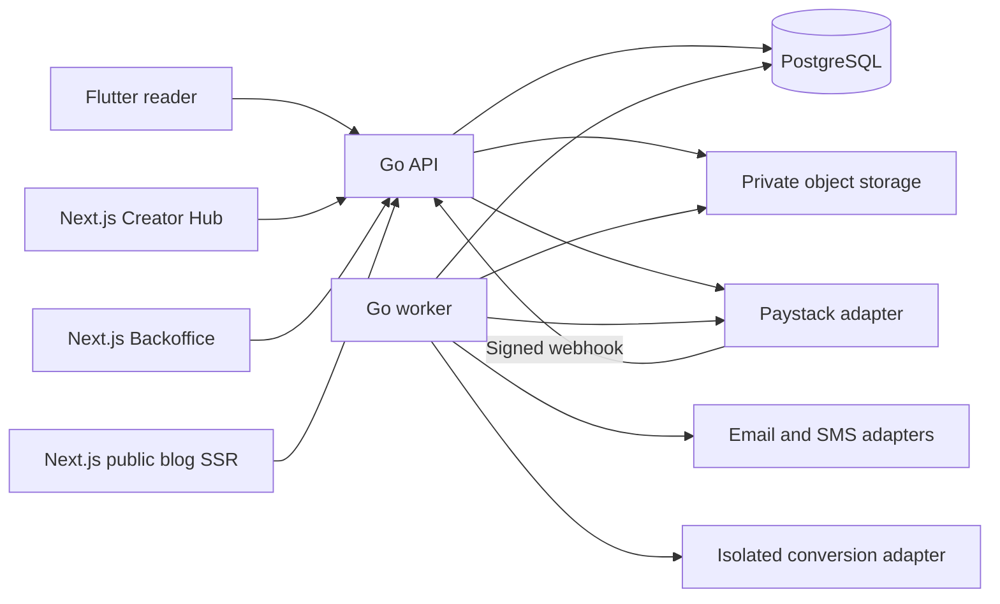

# Target architecture: Go-owned backend

This is a proposal. The existing Firebase implementation remains the behavior reference until each capability is migrated and checked. The target has no Firebase runtime dependency. An explicitly time-limited identity/data compatibility bridge may be needed during migration.

The [title and digital-media specification](TITLES_AND_DIGITAL_MEDIA.md) defines the updated domain: title -> ebook/audiobook delivery -> immutable edition -> assets. Wolly is electronic-only; no physical-book entities or fulfillment are planned.

## Application shape



Start with a modular monolith: one codebase, one database, two commands. Keep HTTP parsing, domain decisions, and SQL separate without inventing a generic repository layer for every table.

```text
backend/go/
  cmd/api/                 HTTP server and dependency wiring
  cmd/worker/              durable jobs and scheduled work
  cmd/migrate/             explicit versioned database migrations
  cmd/import/              repeatable legacy import; added near cutover
  internal/config/
  internal/httpapi/         routing, DTOs, errors, middleware
  internal/identity/        accounts, challenges, credentials, sessions, permissions
  internal/catalog/        titles, eligible deliveries, genres, search, public authors
  internal/reading/         reading/listening progress, bookmarks, follows, preferences
  internal/publishing/      deliveries, editions, reports, agreements, staff review
  internal/rights/          grants, declarations, evidence, availability cases
  internal/commerce/        attempts, purchases, entitlements, refunds
  internal/finance/         ledger, revenue policies, payout runs and statements
  internal/blog/            publications, tiers, drafts, rendering, access, moderation
  internal/subscriptions/   periods, billing state, comps, cancellation
  internal/engagement/      reviews, likes, comments, reports
  internal/notifications/   newsletters, consent, delivery, suppressions
  internal/media/           upload validation, storage adapter, authorized ebook/audio delivery
  internal/audio/           chapter manifests, probing, transcoding, audio quality profiles
  internal/jobs/            inbox/outbox, leases, retries, schedules
  internal/audit/
  internal/providers/      paystack, email, sms, conversion
  migrations/
  api/                     versioned OpenAPI contract and example payloads
```

Use standard `net/http` method/path routes, `encoding/json`, request contexts, `slog`, `httptest`, `database/sql` with pgx, and explicit SQL migrations. Pin supported toolchain/dependency versions when implementation starts. Learn SQL before adding an ORM or code generator. Go's [HTTP library](https://pkg.go.dev/net/http) and [transaction guide](https://go.dev/doc/database/execute-transactions) support this approach; the package boundaries above are a project recommendation.

## Replace platform responsibilities completely

| Current platform behavior | Target responsibility |
| --- | --- |
| Firebase Auth and browser/mobile auth state | Go-owned credentials/verified identities and session lifecycle |
| Firestore reads, writes, transactions, indexes | Scoped SQL queries, explicit service commands, constraints and migrations |
| Firestore security rules | Permission checks and field allowlists in Go; database constraints as additional enforcement |
| Cloud Functions and callable envelopes | Versioned HTTP API and consistent errors |
| Firestore write triggers | Service transactions plus durable outbox jobs; no invisible client side effects |
| Scheduled functions | Worker schedules with persisted run identity, lease recovery and reconciliation |
| Storage upload rules and token URLs | Validated uploads, asset ownership, private storage and authorized delivery |
| Snapshot listeners | Bounded polling with version/ETag first; authenticated SSE only where justified |
| Offline Firestore cache | Explicit per-account device/browser cache; conflict-aware sync |
| Hosting/App Distribution | Separate delivery concern; keep current client hosting/distribution initially |
| Firebase Admin SDK in blog SSR | Ordinary API calls with verified viewer identity; no database bypass in Next.js |

## Identity and permissions

Preserve actual sign-in capabilities rather than silently replacing everything with Ripple's email OTP. Support email/password registration, login, reset and email verification; phone OTP; email magic links; and Google OAuth/OIDC used by the public blog. Go owns the account and links verified identities. Use vetted password hashing and OAuth/OIDC libraries; do not implement cryptography or an identity provider from scratch.

- Store users separately from `auth_identities`, credentials, sessions and staff permission assignments. Same email alone must not silently merge accounts; linking requires proof of control and recent authentication. Imported Firebase UIDs remain stable external IDs.
- Browser sessions use random opaque secrets, hash-only storage, HttpOnly/Secure/SameSite cookies, rotation, absolute expiry, revocation and CSRF tokens plus allowed-origin validation. Put each web app behind its own same-origin `/api` proxy; use a central login/one-use code flow if cross-app SSO is required. Do not depend on cross-domain cookies working accidentally.
- Flutter uses short-lived opaque access tokens with rotating refresh credentials stored in platform secure storage. Store token digests, bind refresh families to devices, detect replay, and revoke on logout/suspension. Browser auth material never lives in localStorage.
- Next.js SSR forwards a validated user's session through its server-side API adapter. It does not accept an arbitrary `userId` header as proof. Personalized body responses use `Cache-Control: private, no-store`.
- OTP and magic-link challenges are single-use, expiring and attempt-limited. Store keyed hashes of low-entropy codes; throttle by destination/account/IP and avoid account-enumeration responses. Separate email/SMS confirmation from profile-editable contact fields.
- Roles: reader and creator capabilities can coexist. Staff permissions include moderation, publishing approval, rights review, finance operations and permission administration. Profile persona and public-author data never grant permissions. Bootstrap the first operator through an audited command; finance approval and permission changes require recent authentication and staff MFA before production.
- Add session listing/revocation, account suspension, recovery and controlled deletion/export. Financial/consent history follows an explicit retention policy; deleting a profile must not erase accounting evidence.

Use [OWASP session guidance](https://cheatsheetseries.owasp.org/cheatsheets/Session_Management_Cheat_Sheet.html) as the implementation baseline. Exact lifetimes and provider choices must be set and tested in B2, including local versus production cookies.

## SQL model

Use opaque text IDs so Firestore document IDs and Firebase UIDs can be imported. New IDs can be generated by Go. Use `TIMESTAMPTZ` for instants, `DATE` for licence calendar dates, and RFC 3339 UTC strings in the API. Store money as `BIGINT` minor units plus currency. Represent new revenue shares as integer basis points; preserve exact legacy snapshots during import and define a tested conversion/rounding policy. Never silently round an unusual legacy share into different earnings.

| Domain | Proposed tables and important constraints |
| --- | --- |
| Identity | `users`, `auth_identities`, `password_credentials`, `auth_challenges`, `sessions`, `device_refresh_tokens`, `staff_permissions`, `user_preferences`; unique provider/subject and verified normalized identity where appropriate |
| Profiles/reference data | `creator_profiles`, `user_genres`, `genres`, `countries`, `supported_currencies`, `payment_methods`, `payment_schedules`; private account fields excluded from public profile responses |
| Catalog/titles | `titles`, `title_metadata_revisions`, `title_contributors`, `title_genres`, `deliveries`, `ebook_details`, `audiobook_details`, `delivery_price_versions`, `delivery_distribution_preferences`; owner FK, version, unique title/kind (ebook or audiobook only), per-delivery workflow/availability |
| Files/press/audio | `assets`, `title_assets`, `delivery_assets`, `manuscripts`, `manuscript_drafts`, `manuscript_revisions`, `audio_chapters`, `editions`, `edition_assets`, `conversion_jobs`, `audio_processing_jobs`; immutable sources/manifests, validated scoped bindings, processor profiles, measured quality and duration |
| Rights | `rights_grants`, `rights_grant_scopes`, `rights_declarations`, `rights_evidence`, `rights_verifications`, `rights_cases`; preserve declaration wording, scope, evidence history and dated decisions |
| Readiness/agreements | `publishing_reports`, `agreement_versions`, `publishing_offers`, `publishing_contracts`, `publication_reviews`; engine/input hash, edition binding, terms snapshot; at most one pending/active contract per delivery |
| Reading | `reading_progress`, `bookmarks`, `author_follows`; unique user/delivery/edition progress; separate `listening_progress` and `audio_bookmarks` with chapter/time locators; unique user/author follow; stable bookmark IDs and locators |
| Reviews/moderation | `book_reviews`, `content_reports`, `moderation_decisions`; unique user/book review, rating bounds, attributable transitions |
| Commerce | `checkout_attempts`, `purchases`, `delivery_entitlements`, `provider_events`, `payment_refunds`; unique provider reference; multiple attempts per user/delivery, one effective entitlement per user/delivery; ebook purchase never grants audio |
| Finance | `revenue_policy_versions`, `sale_transactions`, `ledger_entries`, `payout_destinations`, `payout_runs`, `payouts`, `payout_allocations`; immutable sale snapshots and unique allocations prevent paying the same liability twice |
| Blog | `publications`, `publication_tiers`, `tier_price_versions`, `posts`, `post_drafts`, `post_segments`, `post_revisions`, `post_tier_access`; unique publication slug, unique publication/post slug, body version control |
| Subscriptions | `subscriptions`, `subscription_periods`, `subscription_billing_events`, `complimentary_grants`; unique user/publication relationship and provider charge/period identity |
| Community/stats | `post_likes`, `post_comments`, `comment_likes` if implemented, `post_daily_stats`, `analytics_events`; unique user/post like; one-level same-post reply constraint |
| Delivery/operations | `newsletter_sends`, `newsletter_recipients`, `email_consents`, `email_suppressions`, `notification_deliveries`, `outbox_jobs`, `scheduled_runs`, `idempotency_keys`, `audit_events`, `legacy_import_map`, `import_exceptions` |

Structured JSON is appropriate for a Tiptap draft, conversion diagnostics and immutable imported source snapshots. It should not hide relational ownership, money, workflow state or permission fields. Add indexes for public listings, creator/date sales, pending jobs, moderation queues and user-scoped reading state.

## Business invariants

### Titles, editions and publishing

The following invariants apply **per delivery**. A title holds shared categorisation and approved metadata revisions; each ebook/audiobook delivery has its own content, price, rights, agreement, readiness and publication state. One may be live while the other is absent or draft. The detailed source-dependent rules in [Titles and digital media](TITLES_AND_DIGITAL_MEDIA.md) extend the original manuscript pipeline below.

1. Create a private draft title immediately. Allow only named editable fields, owner-scoped uploads and a monotonically increasing version. Reject stale autosaves with `409` and return the latest version.
2. Upload completion validates actual file content, size and ownership before creating an immutable source version and the appropriate validation/conversion/audio job. Document sources may have separate editable structured drafts; uploaded PDFs/EPUBs stay read-only. Preserve client limits as initial defaults: 50 MiB manuscript, 10 MiB cover. Bound decompressed DOCX/ZIP sizes, image dimensions, node count, recursion depth and processor time as well.
3. Conversion states: `queued -> processing -> ready | failed`; retry creates/claims a controlled attempt. A worker restart can reclaim an expired lease. Compare source version before setting the delivery's candidate edition; an older job cannot overwrite a newer manuscript.
4. Preserve DOCX/Markdown/text ingestion, headings/chapters, embedded images, sanitized markup, supported glyph checks, Wolly fonts, EPUB navigation/metadata, PDF layout, an owner-only opening-pages preview, page count, warnings and provenance. Keep an EPUBCheck-validated fixture corpus and visual PDF checks. Conversion must not fetch arbitrary client URLs or execute manuscript scripts.
5. The readiness engine uses versioned rules and persisted title, edition, profile, payout and rights facts. Retain `title` versus `listing` scope, require a delivery ID for listing checks, and select document/PDF/EPUB/audio rules without sibling-delivery blockers. Preserve the applicable-check denominator, check ownership, blocking subset and next steps. Recompute on reads initially; store snapshots at signing/review. UI previews are advisory.
6. Signing locks/revalidates the delivery version, bound title revision, source edition and offer. The server supplies canonical agreement text/version/hash and freezes price, currency, share, basis, consent and readiness evidence. The user cannot substitute commercial terms or agreement wording. A signed request creates `pending` and moves that delivery to review.
7. Staff approval activates the contract, approves the exact edition/listing, and publishes that delivery in one transaction. Public availability requires a published delivery listing, approved current edition, active contract and permitted rights status. A partial unique index protects against multiple live contracts; services enforce valid transitions too.
8. Replacing a manuscript/audio chapter or changing material metadata on a live delivery creates a pending revision. Keep the approved edition live until the replacement is approved, or explicitly withdraw it. A new upload must not silently replace what staff approved.
9. Ending an agreement closes future sales, records a reason/effective time and retains history. Decide and encode access for previous buyers separately from sale availability; do not conflate unpublish, suspension, expiry and rights revocation.

### Rights and delivery

Rights grants explicitly bind title-wide or delivery-specific scope and describe format, territories, languages, channels, holder, exclusivity, dates, disposition and terms. Staff verification is separate from author declarations and book availability (`clear`, `disputed`, `revoked`). Archive grants rather than destroying their evidence. Derive expiry/90-day warning badges from calendar dates.

The existing download policy is an initial compatibility requirement: owner or published/free/completed-purchase entitlement, revoked blocks everyone, disputed blocks non-owners. Author-only press preview and a deliberately generated reader sample are different assets. Staff evidence/preview access is a new audited permission, not a generic “admin can download everything” bypass.

Audio manifests, chapter playback links/ranges and companion assets use the same delivery-scoped resolver; masters stay private. Title-wide restrictions apply to both modes, delivery restrictions only to the affected mode. Issue short-lived file URLs only after authorization; initially retain the current 15-minute ceiling. Use exact asset keys, permitted format, private buckets and an allowlist for legacy external public-domain sources. A URL already issued remains usable until its expiry unless storage access changes; already downloaded EPUB/PDF files cannot be remotely erased. Provenance identifies a pressing, not a buyer. Per-copy watermarking is an explicitly deferred extension.

### Payments, accounting and payouts

- Bind all catalog purchase attempts, agreements, entitlements and sale snapshots to a delivery; title IDs group them for discovery/reporting. Keep purchased edition/terms history, and never infer cross-mode ownership.
- Create a checkout attempt with a random unique provider reference and immutable expected subject, amount, currency, buyer, author, contract and terms before the provider call. Record `initializing` and recover unknown outcomes after timeout; never hold a SQL lock across the network call.
- Browser/app return is a prompt to verify, not proof of payment. Verify successful provider status, exact amount/currency, reference and expected customer/resource against the persisted attempt. Pending/ongoing provider statuses remain pending. Retried checkout creates another attempt without erasing old references.
- Verify webhook HMAC over bounded raw bytes, persist an inbox record, then acknowledge durable acceptance. If persistence fails return an appropriate retryable failure. Process book and subscription events through the same provider-event infrastructure. Deduplicate by provider event identity where available and by semantic charge/reference/transition identity otherwise.
- Within one SQL transaction lock the attempt, record payment once, create entitlement once, freeze sale/fee/author snapshots and append audit/outbox. Concurrent client verify, webhook and reconciliation must converge. A second successful attempt is an overpayment case to reconcile/refund, not a second entitlement or invisible loss.
- Preserve sale arithmetic: `net = gross - providerFee`; author is rounded once from gross or net according to frozen terms; `platformNet = net - authorEarnings`. Negative platform margin is visible. New settings never rewrite a contract, sale, or payout. Group statements by currency; currency preference does not convert balances.
- Keep immutable sale facts and append-only corrections/refund/reversal entries. A balanced ledger per currency tracks processor clearing, creator payable, fees and platform revenue. Refunds/chargebacks adjust liability and entitlements according to an explicit policy; do not delete historical sales.
- Payouts need a real destination, approval, immutable allocation of eligible liabilities, provider/manual transfer reference and confirmed outcome. Distinguish pending/approved/processing/paid/failed/reversed; hold allocations on ambiguous transfer outcomes so retry cannot pay twice. Mask/encrypt sensitive destination data and audit changes. Start with operator-confirmed manual payouts; automate transfers only once account support and failure recovery are verified.

Paystack documents [signature verification and retry behavior](https://paystack.com/docs/payments/webhooks/) and [transaction verification](https://paystack.com/docs/payments/verify-payments/). The inbox/attempt/ledger rules above are Wolly's proposed safeguards around those provider contracts.

### Blog, subscriptions and delivery

Publish from canonical Tiptap JSON through a server allowlist renderer. Reject unsupported/unsafe links, embeds and images, split free/paid content, derive excerpt/count/reading time, reserve slugs transactionally, snapshot revisions, and atomically update status/access/version. Unpublish/archive/moderate must change all derived access and caches together. Scheduled jobs use a specific frozen draft revision and cannot publish stale or removed content.

One Go access resolver serves mobile, web SSR, RSS, email and exports. Preserve current free/paid segment behavior: public posts expose the free segment publicly; subscriber/paid/tier posts expose that segment to subscribed readers; paid segment requires an unexpired paid period and, for tier visibility, an allowed tier. Owner preview is explicit. Lifecycle and publication suspension are checked before access. Unlisted posts work by direct link but stay out of feeds, RSS and sitemap.

Free subscription, paid access periods, recurring billing and email opt-in are separate facts. Cancellation stops renewal but retains already-paid access through period end. Failed renewal records billing trouble without immediately deleting paid access. Retired tiers retain existing subscriber periods. Complimentary grants must not overwrite a real recurring subscription; define tier scope so a comp is not promised tier-specific access it lacks.

For Wolly's Ghana use case, keep monthly recurring card checkout and annual one-off prepayment. Paystack currently documents recurring support for cards and Nigerian direct debit, not mobile-money recurring mandates ([subscription documentation](https://paystack.com/docs/payments/subscriptions/)). Annual prepay grants a single idempotent twelve-month period from the recorded payment/effective date, never from webhook replay time. Store provider subscription-code mapping so renewal events do not depend on every event repeating custom metadata. Version tier prices and provider plans rather than reusing a cached plan after a price change.

Enforce comment access (`everyone`, `subscribers`, `paid`) plus content visibility, author badge attribution and one-level threading on the server. Persist reports and decisions, not client-editable counters. Use SQL counts first; add rebuildable projections only after measuring a need.

Newsletters are explicit completion work: consent confirmation, welcome email, scheduled sends, free/paid variants, suppression checks, one-click unsubscribe, delivery/bounce/complaint callbacks, deduplication and creator analytics. No protected content in a free recipient's email. Database deduplication cannot promise exactly-once external email after an ambiguous provider timeout; use provider idempotency/status lookup where supported and expose uncertain outcomes.

## Jobs and operations

Use a transactional outbox in PostgreSQL. Jobs have type, payload version, dedupe key, run time, attempts, lease, last error and terminal state. Claim bounded batches with row locks/`SKIP LOCKED`, retry with bounded backoff, and provide an audited dead-letter/retry view. Conversion runs separately from lightweight delivery work with tighter concurrency and resource limits. PostgreSQL's [locking documentation](https://www.postgresql.org/docs/current/explicit-locking.html) explains the locking primitives; leases and dedupe remain application responsibilities.

Scheduled work includes payment reconciliation, subscription recovery/expiry, post publication, newsletters, payout eligibility, rights-expiry reminders, projection repair, upload cleanup and retention. Run schedules from persisted occurrence keys so worker restarts do not repeat effects.

Expose liveness/readiness and a safe capability/status endpoint, structured request IDs, job correlation IDs, queue age, provider failures, unresolved money events and audit search. Do not leak credentials, OTPs, session secrets, private evidence or full payment data to logs. Test DB restore and object restore, use separate staging/production data and provider keys, and deploy Go API/worker independently of the web clients. No Kafka, Redis or Kubernetes is required to begin.
